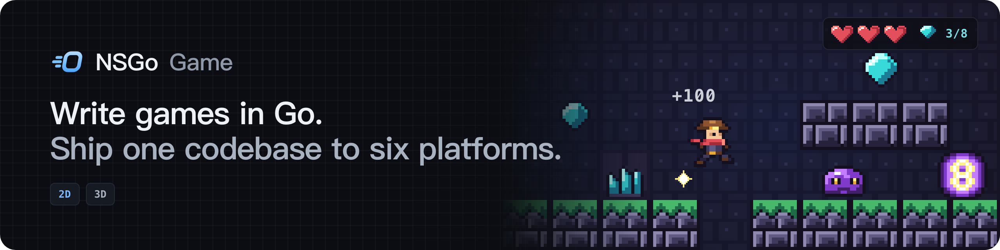

<h1 align="center">
  
</h1>

<p align="center">
  <strong>A pure-Go 2D &amp; 3D game layer for <a href="https://nsgo.dev">NSGo</a> — one codebase across macOS, iOS, Windows, Linux, Android and Web.</strong>
</p>

<p align="center">
  <a href="https://game.nsgo.dev">Website</a> ·
  <a href="https://game.nsgo.dev/docs/">Docs</a> ·
  <a href="https://game.nsgo.dev/zh/docs/">中文文档</a> ·
  <a href="https://game.nsgo.dev/playground/">Playground</a> ·
  <a href="https://game.nsgo.dev/showcase/">Showcase</a> ·
  <a href="https://game.nsgo.dev/docs/api/">API Reference</a> ·
  <a href="https://game.nsgo.dev/llms.txt">llms.txt</a>
</p>

---

**NSGo Game** (`github.com/nsgo-dev/game`) adds everything you need to build and ship complete 2D and 3D games in [NSGo](https://github.com/nsgo-dev/nsgo) apps—using pure Go with zero hand-written C.

Your game draws into one NSGo view (`Canvas`, pixel buffer, shader, or GPU view) while its HUD, pause screens, dialogues and settings remain ordinary native NSGo views with native typography, input methods and accessibility. Every package imports independently and uses only NSGo's public API, so an app that does not import a package links none of it.

## Highlights

- **Pure Go, six build targets**: Ship one Go codebase to **macOS, iOS, Windows, Linux, Android and Web**—zero hand-written C or `cgo` ([Platform Support](docs/en/platforms.md)).
- **Drawn game, native UI**: Render your world at 60 fps or display refresh rate in a single view while keeping scores, menus and dialogs native NSGo views.
- **2D & 3D on one shared foundation**: Fixed-step `game.Loop`, input actions, sound mixer, assets, saves and scene transitions are shared between 2D and 3D—mix both freely in one game.
- **Visual 2D & 3D scene editor**: Run `game editor` for a live viewport, scene hierarchy, inspector, transform gizmos, asset browser and Go plugin API ([Editor Guide](docs/en/editor.md)).
- **Plain-text YAML everything**: Scenes, prefabs, materials, animations, data tables, bullet patterns, quests, input maps and project settings are versioned, schema-validated YAML—clean to review in Git and easy for both humans and AI agents to edit ([File Formats](docs/en/formats.md)).
- **Built for AI coding agents**: Ships `llms.txt` / `llms-full.txt`, JSON Schemas, runtime scene inspection via [`game/mcp`](docs/en/mcp.md), deterministic [`statedump`](docs/en/statedump.md) diffs and an installable [Agent Skill](docs/en/agent-skill.md).
- **141 modular packages & 16 starter templates**: From sprites, tilemaps and rigid-body physics to glTF PBR rendering, dedicated servers and self-hosted leaderboards—every package documented and marked `stable` or `experimental` ([API Stability](docs/en/stability.md)).

## Quick Start

Requires **Go 1.27+** and **NSGo `v0.3.4+`** (iOS builds require macOS and Xcode).

```sh
# 1. Create a new game project (add -template <name> to pick from 16 genres)
go run github.com/nsgo-dev/game/cmd/game@latest new mygame

# 2. Run natively with hot reload on save
cd mygame
go tool nsgo dev

# 3. Run in the browser (WebAssembly)
go tool nsgo dev -target web
```

Or download the standalone desktop **NSGo Game Editor** from [GitHub Releases](https://github.com/nsgo-dev/game/releases/latest) (macOS `.dmg`, Windows `-setup.exe`, Linux `.AppImage`/`.deb`/`.pkg.tar.gz`), launch it from Go, or install the coding-agent skill:

```sh
# Install the standalone NSGo Game Editor (macOS / Linux)
curl -fsSL https://github.com/nsgo-dev/game/releases/latest/download/install.sh | sh

# Or run the scene editor directly via Go
go run github.com/nsgo-dev/game/cmd/game@latest editor

# Install the Agent Skill for coding agents
bunx skills add nsgo-dev/game
```

See [Getting Started](docs/en/getting-started.md) ([中文](docs/zh/getting-started.md)) for the full walkthrough, or follow the 9-chapter [Tutorial: Star Catcher](docs/en/tutorial.md) ([中文](docs/zh/tutorial.md)) from an empty project to a shipped game.

## Package Overview

Import only what you need from `github.com/nsgo-dev/game`. Browse the full interactive catalog of all 141 packages at [game.nsgo.dev/packages](https://game.nsgo.dev/packages/) or check [API Stability](docs/en/stability.md) ([中文](docs/zh/stability.md)).

| Area | Key Packages |
| --- | --- |
| **Core 2D** | `game` ([Loop](docs/en/loop.md)), `sprite`, `tilemap`, `tilemap/tileshape`, `scene`, `screen`, `input`, `sound`, `text`, `assets`, `resource`, `save`, `math2d` |
| **Physics & Navigation** | `physics`, `physics/rigid` ([2D Rigid](docs/en/physics2d-rigid.md)), `physics3d`, `ai`, `ai/perception3d`, `ai/navbake`, `ai/navbake3d`, `vehicle` |
| **3D & Rendering** | `math3d`, `scene3d`, `render3d`, `gltf`, `scenemodel`, `anim3d`, `world3d`, `voxel` ([Blender Guide](docs/en/3d-models-blender.md)) |
| **Animation & Visual FX** | `tween`, `animclip`, `skeletal`, `particles`, `pixelfx`, `lights2d`, `effects`, `cutscene`, `quality` |
| **Gameplay & Genre Kits** | `flow`, `entities`, `platformer`, `rooms`, `worldmap`, `fog`, `procgen`, `stats`, `inventory`, `ability`, `quest`, `loot`, `cards`, `bullets`, `fighting`, `framedata`, `rts`, `rhythm`, `idle`, `vn`, `undo` |
| **UI, L10n & Accessibility** | `gameui`, `l10n`, `a11y`, `perf` |
| **Multiplayer & Online** | `online/netplay`, `online/server`, `online/accounts`, `online/cloudsave`, `online/leaderboard`, `online/leaderboard/selfhost`, `online/achievements`, `online/presence`, `online/liveops`, `modding` |
| **Editor, Tooling & Testing** | `editor`, `project`, `refs`, `debug`, `mcp`, `replay`, `statedump`, `playtest`, `gametest`, `placeholder`, `datatable`, `jsonschema`, `tooling/library` |

## Starter Templates

Scaffold a working, tested game in any of 16 genres with `game new -template <name> mygame` (or `nsgo init -template github.com/nsgo-dev/game/template/<name>`). Run `game new -list` or read [Templates](docs/en/templates.md) ([中文](docs/zh/templates.md)) for details.

| 2D Templates | Description | 3D & Specialty Templates | Description |
| --- | --- | --- | --- |
| `starter` | Minimal tap-to-score 2D starter (default) | `action3d` | Third-person 3D action adventure with orbit camera & blended animations |
| `platformer2d` | Side-scrolling platformer with coyote time, jump buffer & rooms | `fps3d` | First-person 3D shooter arena with hitscan/projectile weapons & AI waves |
| `rpg2d` | Top-down RPG with branching dialogue, inventory, quests & saves | `racing3d` | 3D raycast-car circuit racer with rivals, checkpoints & best-lap ghost |
| `roguelike2d` | Seeded 5-floor turn-based roguelike with BSP caves & loot tables | `fighting2d` | 1v1 2D fighter with motion inputs, combos, frame data & CPU opponent |
| `towerdefense2d` | Upgradeable towers, YAML enemy waves, economy & lives | `cards2d` | Drag-and-drop single-player card game with YAML deck & deals |
| `rts2d` | Real-time strategy skirmish with fog of war, flow fields & control groups | `puzzle2d` | Grid sliding puzzle with YAML levels, undo/redo & star ratings |
| `shmup2d` | Vertical shooter with YAML bullet patterns, waves & 3-phase boss | `rhythm` | 4-lane rhythm game with beat maps, audio clock & latency calibration |
| `idle` | Generators, upgrades, big numbers, offline progress & prestige | `visualnovel` | Branching Yarn Spinner visual novel with backlog, saves & EN/中文 |

## Playable Examples

Try the examples directly in your browser in the [Playground](https://game.nsgo.dev/playground/) or run them locally with `go tool nsgo dev ./examples/<name>`.

| Example | Genre / Focus | Source |
| --- | --- | --- |
| **Cave Run** | Side-scrolling 2D platformer with native HUD & menus | [`examples/caverun`](examples/caverun/) |
| **Crypt Quest** | Top-down tile dungeon adventure across all six targets | [`examples/cryptquest`](examples/cryptquest/) |
| **Starburst** | Twin-stick arena shooter with particles, physics & input | [`examples/starburst`](examples/starburst/) |
| **Fountain** | Particle stress test maintaining 5,000 live particles | [`examples/fountain`](examples/fountain/) |
| **Slide Gem** | Touch-first 6×6 sliding match-3 with zero external assets | [`examples/slidegem`](examples/slidegem/) |
| **Lantern 3D** | 2D ↔ 3D scene switching with glTF diorama, PBR lighting & shared input/audio | [`examples/lantern3d`](examples/lantern3d/) |
| **Field Medic** | Small game shipping its own scene editor and editor plugin | [`examples/fieldmedic`](examples/fieldmedic/) |
| **Star Catcher** | Complete 9-chapter step-by-step tutorial game | [`examples/tutorial`](examples/tutorial/) |
| **VN Sample** | Two-character visual novel scene with choices, backlog, auto and skip | [`examples/vnsample`](examples/vnsample/) |
| **Dedicated Server** | Fixed-step match in a plain Go process, no NSGo app or cgo (`go build`, not `nsgo dev`) | [`examples/dedicatedserver`](examples/dedicatedserver/) |

## Documentation

| Topic | English | 简体中文 |
| --- | --- | --- |
| Overview & Architecture | [Overview](docs/en/index.md) | [概览](docs/zh/index.md) |
| Installation & First Game | [Getting Started](docs/en/getting-started.md) | [快速开始](docs/zh/getting-started.md) |
| 9-Chapter Walkthrough | [Tutorial: Star Catcher](docs/en/tutorial.md) | [教程：Star Catcher](docs/zh/tutorial.md) |
| Visual Scene Editor | [Scene Editor](docs/en/editor.md) | [场景编辑器](docs/zh/editor.md) |
| Plain-Text YAML Formats & Schemas | [File Formats](docs/en/formats.md) · [Schemas](docs/en/schemas.md) | [文件格式](docs/zh/formats.md) · [Schema](docs/zh/schemas.md) |
| Starter Templates & CLI | [Templates](docs/en/templates.md) · [CLI](docs/en/cli.md) | [模板](docs/zh/templates.md) · [命令行](docs/zh/cli.md) |
| 3D & Blender Pipeline | [3D Models from Blender](docs/en/3d-models-blender.md) | [从 Blender 导入 3D 模型](docs/zh/3d-models-blender.md) |
| AI Agents & MCP | [MCP](docs/en/mcp.md) · [Agent Skill](docs/en/agent-skill.md) | [MCP](docs/zh/mcp.md) · [智能体技能](docs/zh/agent-skill.md) |
| Migrating from Another Engine | [Godot](docs/en/from-godot.md) · [Unity](docs/en/from-unity.md) · [Ebitengine](docs/en/from-ebitengine.md) | [Godot](docs/zh/from-godot.md) · [Unity](docs/zh/from-unity.md) · [Ebitengine](docs/zh/from-ebitengine.md) |
| API Stability, Platforms & Shipping | [API Stability](docs/en/stability.md) · [Platform Support](docs/en/platforms.md) · [Building & Shipping](docs/en/shipping.md) | [API 稳定性](docs/zh/stability.md) · [平台支持](docs/zh/platforms.md) · [构建与发布](docs/zh/shipping.md) |

## Repository Layout

```text
game/
├─ go.mod / go.work     Go module github.com/nsgo-dev/game (root package game at root)
├─ cmd/                 binaries shipped to users (game, nsgo-game, gameproject, sizecheck, and the service daemons)
├─ internal/            shared helpers, CLI implementation, repo-wide checks and the sizeprobe CI fixture
├─ pkg/                 library packages (github.com/nsgo-dev/game/pkg/<name>)
│  ├─ online/           online services and netplay
│  └─ tooling/          build, editor and dev-time tooling
├─ template/            16 Go-module starter templates for game new / nsgo init
├─ examples/            playable sample games, the dedicated server and visual-novel samples, and the 9-chapter tutorial
├─ library/             shared asset, plugin and template library index
├─ skills/              Agent Skills package (bunx skills add nsgo-dev/game)
├─ docs/                bilingual site documentation (en/ and zh/)
├─ design/editor/       editor design artboards that pkg/editor implements
├─ apps/website/        official site at https://game.nsgo.dev (TanStack Start + React)
├─ benchmarks/          bench baseline and package size budgets
├─ tools/               contributor tooling module (changelog, agenteval, gameschema, gameapi, pixelfxref)
└─ changelog.d/         release changelog fragments
```

## Targets & Compatibility

| `game` | Go | NSGo | Build targets |
| --- | --- | --- | --- |
| `v0.1.0` | `1.27+` | `v0.3.4+` | macOS, iOS, Windows, Linux, Android, Web ([feature matrix](docs/en/platforms.md)) |

Feature support and CI test coverage differ by target—see [Platform Support](docs/en/platforms.md) ([中文](docs/zh/platforms.md)) for the per-feature matrix, experimental targets (HarmonyOS, tvOS, watchOS and mini programs) and upstream gap links. Consoles (Nintendo Switch, PlayStation and Xbox) are out of scope: their SDKs are under NDA and require C toolchains, whereas NSGo and this repository are pure Go with no hand-written C. See [Building and Shipping](docs/en/shipping.md) for signing, notarization, store packaging and cross-target `nsgo check`.

## Contributing & License

Contributions are welcome—see [CONTRIBUTING.md](CONTRIBUTING.md) for local test commands, cross-target checks, coding conventions and pull request guidelines.

Licensed under the [Apache-2.0 License](LICENSE).
