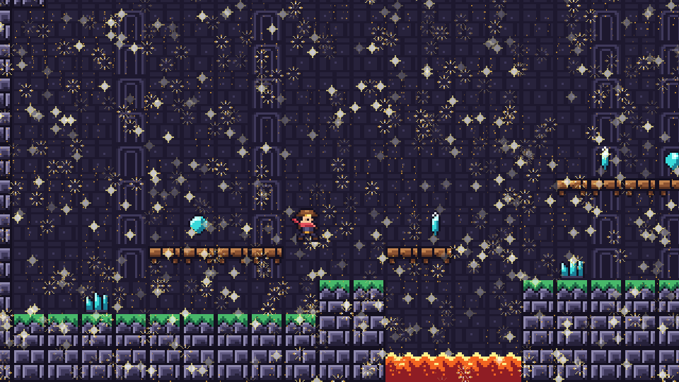

# Cave Run

Cave Run is the playable sample game for [`github.com/nsgo-dev/game`](../../README.md): a short side-scrolling platformer in which an explorer crosses three cave chambers, collects gems, hops over slimes and lava, and reaches the exit portal. The game draws into one NSGo `Canvas`; its HUD, title, pause menu and end screens are native NSGo views on top.



The screenshot is the game view a moment into a run with the stress swarm on. `TestScreenshot` renders it from the canvas's recorded drawing with `gametest.RenderOps` and fails when the game's picture drifts from it; `go tool nsgo test -run TestScreenshot ./ -update-golden` redraws it.

It uses the packages a 2D game is made of:

| Package | Where |
| --- | --- |
| `game.Loop` | the fixed 60 Hz step and the interpolated draw (`game.go`) |
| `input` | one set of actions for the keyboard, game controllers, touch and the mouse (`bindControls` in `game.go`) |
| `sprite` | the Aseprite atlas, animations and one `Batch` for every sprite (`level.go`, `swarm.go`) |
| `tilemap` | the Tiled map `assets/level1.tmj` and its following, shaking camera |
| `scene` | the title, playing, victory and game-over scenes, and the level's drawing layers |
| `sound` | the `sfx` and `music` groups of a `Mixer`, with volumes the pause menu sets |
| `screen`, `physics`, `particles`, `text` | the letterboxed 320×180 view, tile collisions, dust and sparks, and the bitmap font |

[DESIGN.md](DESIGN.md) describes the level, the art and the sound, and [CREDITS.md](CREDITS.md) their license: all of it is original and generated by `tools/genassets`.

## Play

From `examples/caverun/`:

```sh
go tool nsgo dev                 # run it on this computer
go tool nsgo dev -target web     # run it in a browser
go tool nsgo build               # build every target in nsgo.yaml
```

| Action | Keyboard | Game controller | Touch and mouse |
| --- | --- | --- | --- |
| Move | `A` `D`, `←` `→` | left stick, D-pad | the `<` `>` buttons, or the lower-left of the screen |
| Jump (hold to jump higher) | `Space`, `W`, `↑`, `Z` | South (A, Cross) | the `JUMP` button, or the lower-right of the screen |
| Start, play again | `Enter` | Start | Play, Play Again |
| Pause, resume | `Esc`, `P` | Start | Pause |
| Restart | `R` | Back (Select) | Restart in the pause menu |
| 1000-firefly stress swarm | `F` | North (Y, Triangle) | Fireflies in the pause menu |

Keys count wherever the keyboard focus is, and every connected controller plays.

## Start a game with the package

A game is an NSGo component. It binds its actions once, runs a `game.Loop` on its scope, steps the actions at the start of each fixed update, and redraws a `Canvas` from the loop's `Draw`. This is Cave Run's skeleton, cut down to one sprite:

```go
package main

import (
	_ "embed"
	"time"

	"github.com/nsgo-dev/game/packages/game"
	"github.com/nsgo-dev/game/packages/game/input"
	"github.com/nsgo-dev/game/packages/game/sprite"
	"github.com/nsgo-dev/nsgo"
	"github.com/nsgo-dev/nsgo/core"
	"github.com/nsgo-dev/nsgo/gamepad"
)

//go:embed assets/sprites.json
var spritesJSON []byte

func Game(cx *core.Scope) core.Node {
	atlas, err := sprite.LoadAtlas(core.Src("asset:sprites.png"), spritesJSON)
	if err != nil {
		panic(err)
	}
	hero := sprite.NewSprite(atlas.Frames["hero_idle_0"])
	hero.X, hero.Y = 152, 120
	batch := &sprite.Batch{Atlas: atlas, Sprites: []*sprite.Sprite{&hero}}

	actions := input.NewActions()
	actions.Bind("left", input.Key("a"), input.Key("left"), input.GamepadButton(gamepad.ButtonDPadLeft))
	actions.Bind("right", input.Key("d"), input.Key("right"), input.GamepadButton(gamepad.ButtonDPadRight))
	actions.BindAxis("move", "left", "right")
	actions.BindGamepadAxis("move", gamepad.AxisLeftX, input.GamepadAxisOptions{})
	actions.WatchKeys(cx)
	actions.WatchGamepads(cx)

	x, lastX := hero.X, hero.X
	alpha := 0.0
	// A signal skips a Set of an equal value, so a counter that changes every frame, not alpha, redraws the Canvas.
	frame := core.NewSignal(cx, 0)
	loop := &game.Loop{
		Rate: 60,
		Update: func(dt time.Duration) {
			actions.Step()
			lastX = x
			x += float32(actions.Axis("move")) * 98 * float32(dt.Seconds())
		},
		Draw: func(a float64) {
			alpha = a
			frame.Update(func(n int) int { return n + 1 })
		},
	}
	loop.Run(cx)

	return core.Canvas{
		Style: core.Style{FlexGrow: 1, Background: core.RGB(0x131628)},
		Draw: func(d *core.Drawing, _ core.Size) {
			frame.Get()
			hero.X = lastX + (x-lastX)*float32(alpha)
			batch.Draw(d)
		},
	}
}

func main() { nsgo.Run(Game) }
```

Cave Run adds the rest on the same frame: `screen.Viewport` letterboxes the 320×180 game into any window, `scene.Manager` switches between the title, the level and the end screens, the level is a `scene.Scene` holding the Tiled map and the sprite batch under a `tilemap.Camera`, and the HUD is ordinary NSGo views stacked over the `Canvas` (`hud.go`). The [Getting Started](../../docs/en/getting-started.md) guide walks through each piece.

## Performance

`F`, North on a controller, or Fireflies in the pause menu turns on the stress swarm: 1000 fireflies drift and twinkle over the view on top of the level's own sprites, and the HUD shows the frame's sprite count, `SPRITES 1012`. They share one `Z` and stay below full opacity, so the batch draws all of them with one `DrawAtlas`, and moving them allocates nothing.

`BenchmarkLevel1000Sprites` runs the level with the swarm on, headless:

```sh
go tool nsgo test -run '^$' -bench BenchmarkLevel1000Sprites ./
```

| Machine | One fixed step | Step and the frame's drawing |
| --- | --- | --- |
| Apple M1 Max, macOS arm64 | 19 µs, 1 allocation | 104 µs, 314 allocations |
| AMD Ryzen 9 3900X, Linux amd64 | 26 µs, 1 allocation | 218 µs, 314 allocations |

Both stay far below the 16.7 ms a 60 Hz frame allows, and the 8.3 ms of a 120 Hz one. The step's one allocation is the contact list `physics.MoveAndSlide` returns. The drawing's come from NSGo v0.3.0's `Drawing`, which copies the image of every tile it draws onto the heap; the swarm adds the copies for its own `DrawAtlas` and for the second run it splits the level's sprites into (it sits between the gems and the slimes and explorer), and `TestSwarmAddsNoAllocations` holds it to that.

The frame rate on each platform comes from NSGo's performance monitor: run the game with `go tool nsgo dev -fps` (or start a build with `--nsgo-fps`, or open the web build with `?nsgo-fps`), start a run, turn the swarm on, and read the monitor after the level has played for a minute.

| Target | Device | Display rate | With 1000 sprites |
| --- | --- | --- | --- |
| macOS | MacBook Pro, Apple M4 Pro | 120 Hz | 29–30 fps on NSGo v0.3.4; **119–120 fps** (0% dropped) with NSGo `Canvas.ResolutionScale` + batched Apple `DrawAtlas` ([nsgo#2525](https://github.com/nsgo-dev/nsgo/pull/2525)) |
| Windows | not measured on physical GPU yet | | |
| Linux | not measured on physical display yet | | |
| Web | Google Chrome, Apple M4 Pro | 60 Hz | **60 commits/s** (0% dropped, app 0.65 ms, core 0.35 ms) |
| iOS | iPhone 17 (`iPhone18,3`) | 120 Hz | ~12.5 fps on NSGo v0.3.0; re-test pending NSGo release with `Canvas.ResolutionScale` + [nsgo#2525](https://github.com/nsgo-dev/nsgo/pull/2525) (60 fps target) |
| Android | Google Pixel 3 XL (Android 12) | 60 Hz | **59–60 fps** (0% dropped, frame 0.24–0.35 ms, 60 commits/s) |

These need real devices with GPU-attached displays, so the remaining cells are filled in as each target is measured ([#64](https://github.com/nsgo-dev/game/issues/64), [#8](https://github.com/nsgo-dev/game/issues/8)).

## Tests

```sh
go tool nsgo test ./...
go tool nsgo check -target macos,windows,linux,android,web
```

The `nsgotest` tests run the game headless on a manual frame clock. `TestPlayLevelStartToEnd` plays the level from the spawn point to the exit portal four times, with the HUD's touch buttons, held keyboard keys, a game controller, and held keys with the 1000-firefly swarm on, then plays again from the victory screen. Others cover the pause menu and mixer, lava and slime damage down to game over, mouse regions, the controller's dead zone, pause, restart and disconnect, the swarm's single `DrawAtlas` and its determinism, and the landscape lock on phones.
